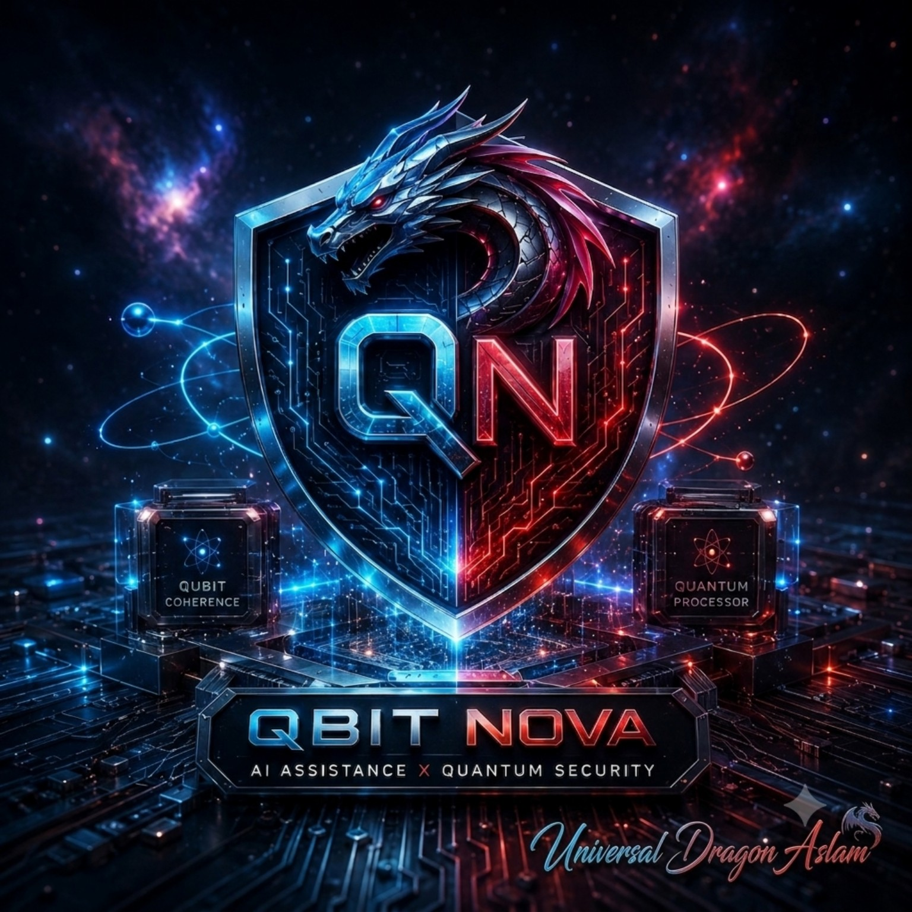

<p align="center">
  
</p>

# QBIT NOVA Native

**Native C17 programming language, deterministic QBC/QVM runtime, software virtual QCPU, and approval-first execution security.**

> Research Preview
> Created by Universal Dragon Aslam

## Truth boundary

```text
physical_qpu=false
runtime=software_virtual_qcpu
python_dependency=false
release_class=research_preview
```

QBIT NOVA does not claim that Raspberry Pi 5 or ordinary software becomes a physical quantum computer.

It currently implements quantum-state simulation and a secure native execution architecture.

## Native pipeline

```text
QBIT NOVA source
→ deterministic lexer
→ parser
→ typed AST
→ typed QIR
→ QBC bytecode
→ QVM
→ capability guard
→ authenticated approval
→ trusted issuer
→ replay protection
→ bounded execution
→ evidence receipt
```

## Current features

- Native C17 implementation
- Deterministic lexer, parser, QIR, QBC, and QVM
- Software state-vector quantum simulation
- Deny-by-default capability guard
- OpenSSL Ed25519 signed approvals
- Strict trusted-issuer store
- Atomic persistent replay ledger
- Replay protection for `run` and `exec`
- Strict token and issuer revocation-store foundation
- Deterministic execution results and receipts
- `shell.exec` blocked by default

## Security status

| Layer | Status |
|---|---|
| Ed25519 approvals | Implemented |
| Trusted issuer store | Implemented |
| Replay ledger | Implemented |
| Run replay protection | Implemented |
| Exec replay protection | Implemented |
| Token revocation lookup | Implemented |
| Issuer revocation lookup | Implemented |
| Revocation execution wiring | Pending |
| Stage 5.2 freeze | Pending |

Revocation-store parsing and lookup are implemented, but revocation is not yet connected to the final `run` and `exec` execution boundary.

HMAC v0.4 remains a legacy compatibility path without Ed25519 replay-ledger enforcement.

## Build and test

Requirements:

- C17 compiler
- GNU Make
- OpenSSL development package
- `pkg-config`

```bash
make
make test
```

Strict build flags:

```text
-std=c17
-O2
-Wall
-Wextra
-Wpedantic
-Werror
```

## Current security order

```text
signed approval
→ trusted issuer verification
→ capability validation
→ bounded preflight
→ replay consume
→ execution
```

Planned next order:

```text
signed approval
→ trusted issuer verification
→ revocation check
→ capability validation
→ bounded preflight
→ replay consume
→ execution
```

## Project status

This repository is an active research preview.

It is not yet a production security product, physical quantum computer, or final QBIT NOVA release.

## License

No open-source license has been assigned yet.

Public visibility does not automatically grant redistribution, modification, or commercial-use rights.
